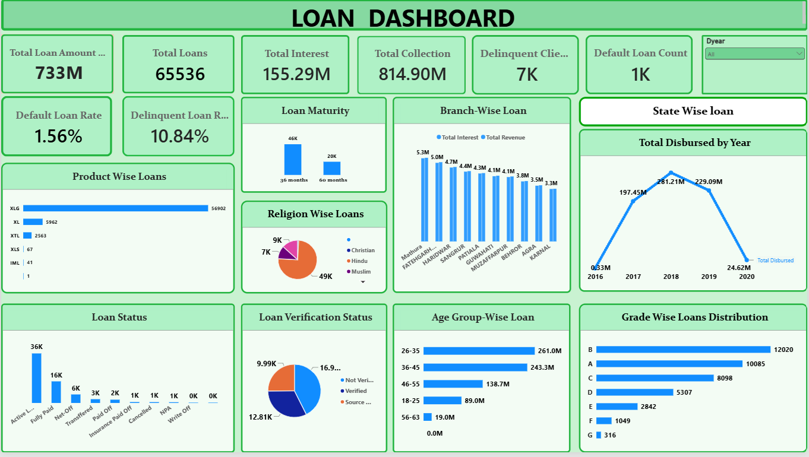
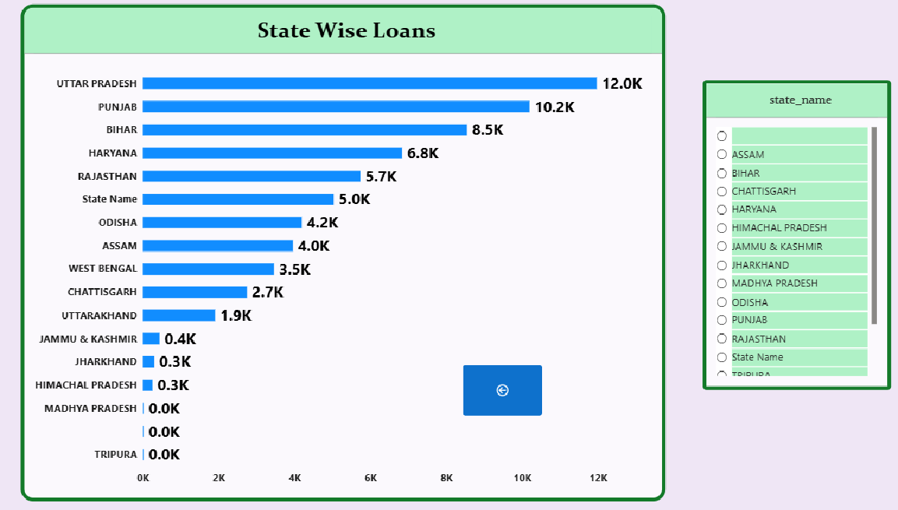

# Banking Data Analysis

## Project Overview

This project analyzes banking data to evaluate loan portfolio performance and debit and credit transaction patterns. It uses Excel, MySQL, Power BI, and Tableau to prepare data, calculate key performance indicators (KPIs), and create dashboards that support data-driven decision-making.

The project demonstrates practical data analytics skills through data preparation, SQL queries, KPI calculations, dashboard development, and business reporting.

## Project Objectives

* Analyze loan portfolio performance and key loan KPIs.
* Examine debit and credit transaction activity.
* Analyze state-wise loan distribution.
* Create interactive dashboards to visualize banking metrics and trends.
* Use SQL queries to calculate and analyze key indicators.
* Present analytical work through dashboards and a project presentation.

## Tools and Technologies

* **Microsoft Excel** – Data analysis, KPI calculations, and dashboard creation.
* **Power Query** – Data cleaning and transformation.
* **MySQL** – Database setup, data preparation, and analytical queries.
* **Microsoft Power BI** – Interactive dashboards, KPI cards, charts, and report navigation.
* **Tableau** – Dashboard development and data visualization.
* **Microsoft PowerPoint** – Project presentation.

## Project Components

### 1. Excel Dashboards

This project includes two Excel dashboards:

* **Loan Dashboard** – Analyzes loan portfolio performance and related KPIs.
* **Debit and Credit Dashboard** – Analyzes banking transactions and debit and credit activity.

**Files:**

* [Loan Dashboard](Excel/LOAN%20final%20dashboard.xlsx)
* [Debit and Credit Dashboard](Excel/DC%20Final%20Dashboard.xlsx)

### 2. SQL Analysis

MySQL is used for database setup, data preparation, and banking KPI analysis.

**SQL files:**

* [Database and Table Setup](SQL/01_Database_and_Table_Setup.sql)
* [Loan Dashboard KPI Queries](SQL/02_Loan_Dashboard_KPIs.sql)
* [Debit and Credit Dashboard Queries](SQL/03_Debit_Credit_Dashboard.sql)

**Key activities:**

* Database and table setup.
* Data preparation and date conversion.
* KPI calculations and aggregation.
* Loan performance analysis.
* Debit and credit transaction analysis.

### 3. Power BI Dashboards

This project includes two Power BI dashboards.

#### A. Loan Dashboard

The Loan Dashboard presents loan-related KPIs and visualizations. It also includes a separate **State-Wise Loan Distribution** page, accessible through a navigation button.

**Main Loan Dashboard**



**State-Wise Loan Distribution**



#### B. Debit and Credit Dashboard

The Debit and Credit Dashboard focuses on transaction analysis, including credit amount, debit amount, net transaction amount, credit-to-debit ratio, and other transaction-related KPIs.

**Files:** [View Power BI Dashboards](Power-BI/)

A screenshot of the Debit and Credit Dashboard can be added here when available.

### 4. Tableau Dashboards

This project includes two Tableau dashboards.

#### A. Loan Dashboard

The Loan Dashboard presents loan performance and related banking metrics through visualizations designed to support analysis and comparison.

#### B. Debit and Credit Dashboard

The Debit and Credit Dashboard presents transaction-related metrics and visualizations for examining debit and credit activity.

**Files:** [View Tableau Dashboards](Tableau/)

Screenshots of both Tableau dashboards can be added to this README when available.

### 5. Project Presentation

The PowerPoint presentation summarizes the project objectives, analytical approach, dashboards, KPIs, and findings.

**Files:** [View Project Presentation](Presentation/)

## Skills Demonstrated

* Data cleaning and preparation.
* Exploratory data analysis.
* SQL querying and aggregation.
* KPI calculation and reporting.
* Banking and loan analytics.
* Debit and credit transaction analysis.
* Dashboard design and data visualization.
* Interactive report navigation.
* Analytical communication and presentation.

## Repository Structure

```text
banking-data-analysis/
│
├── Excel/
│   ├── DC Final Dashboard.xlsx
│   └── LOAN final dashboard.xlsx
│
├── SQL/
│   ├── 01_Database_and_Table_Setup.sql
│   ├── 02_Loan_Dashboard_KPIs.sql
│   └── 03_Debit_Credit_Dashboard.sql
│
├── Power-BI/
│   └── Power BI dashboard files
│
├── Tableau/
│   └── Tableau dashboard files
│
├── Presentation/
│   └── Project presentation
│
├── Screenshots/
│   ├── loan-dashboard.png
│   └── state-wise-loan-distribution.png
│
├── .gitattributes
└── README.md
```

*Note: The repository structure is illustrative. The actual filenames and extensions may differ.*

## Conclusion

This Banking Data Analysis project demonstrates the practical application of Excel, Power Query, MySQL, Power BI, and Tableau to banking data. It combines data preparation, SQL analysis, KPI calculations, and dashboard development to present banking metrics in a clear and structured way.

The repository serves as a portfolio of analytical work and can be expanded with additional dashboard screenshots, query explanations, and project improvements.
